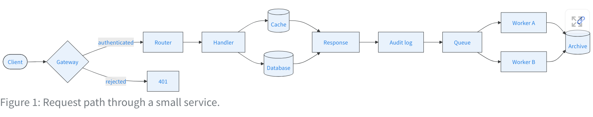
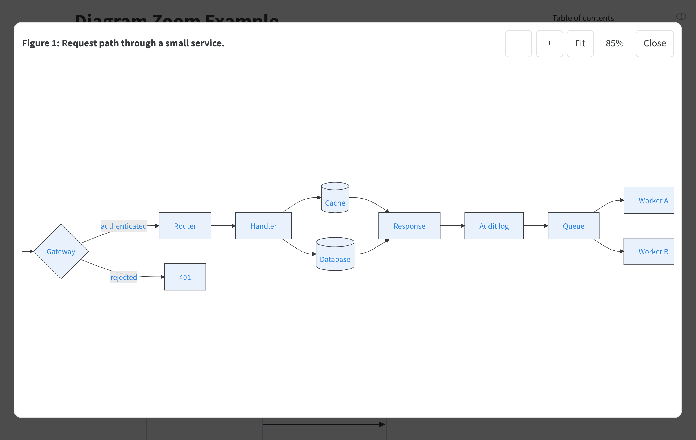

# diagram-zoom — zoom and pan for Quarto diagrams

[](https://github.com/Lightbridge-KS/quarto-diagram-zoom/actions/workflows/ci.yml)
[](LICENSE)
[](https://lightbridge-ks.github.io/quarto-diagram-zoom/)

A [Quarto](https://quarto.org) filter extension that adds an **Enlarge** button to every
Mermaid and Graphviz diagram in HTML output. The button opens a full-window viewer where the
diagram can be zoomed and panned — handy for wide flowcharts that a text column squeezes into
illegibility.

**[Live demo →](https://lightbridge-ks.github.io/quarto-diagram-zoom/)** (the rendered
[example.qmd](example.qmd)).





- Works with Quarto's own diagram rendering: Mermaid (`mermaid-format: js` and `svg`) and
  Graphviz (`{dot}` cells). No extra JavaScript library, no network requests.
- HTML documents, websites, and **books** — enable it once in `_quarto.yml`.
- Follows the page theme, including Quarto's light/dark toggle.
- Vector stays sharp at every zoom level; the diagram is moved into the viewer and back, so
  arrowheads and Mermaid styles keep working.
- Keyboard and screen-reader friendly: a labelled button, a modal dialog that traps focus,
  zoom level announced, focus returned on close.

## Install

Run in the project root (or next to a standalone document):

```bash
quarto add Lightbridge-KS/quarto-diagram-zoom@v0.1.0
```

`quarto add Lightbridge-KS/quarto-diagram-zoom` (no tag) installs the current `main`.
The extension lands in `_extensions/` — commit that directory with the project.

Requires Quarto 1.6 or later.

## Use

Add the filter to a document's front matter:

```yaml
---
title: My report
filters:
  - diagram-zoom
---
```

or, for a whole **book** or **website**, to `_quarto.yml`:

```yaml
project:
  type: book

filters:
  - diagram-zoom
```

Every Mermaid and Graphviz diagram then gets the button. There is nothing to configure.

### Leave a diagram out

Wrap it in a `.no-zoom` div:

````markdown
::: {.no-zoom}
```{mermaid}
flowchart LR
  small --> diagram
```
:::
````

## In the viewer

| Input | Action |
|---|---|
| Mouse wheel, trackpad scroll | Zoom at the pointer |
| Trackpad or touchscreen pinch | Zoom at the pinch |
| Drag (mouse, one finger) | Pan |
| `+` / `−` · toolbar buttons | Zoom in / out |
| `0` · **Fit** | Fit the diagram to the window |
| Arrow keys | Scroll |
| `Esc` · **Close** · click outside | Close |

## What it covers

| Output | Behaviour |
|---|---|
| `html` documents, websites, books | Enabled |
| `revealjs` and other slide formats | Left untouched (not supported yet) |
| PDF, Word, EPUB, … | Left untouched |
| `dashboard`, `email` | Pass the HTML check but are untested |

- **Diagrams only.** Raster images — including `mermaid-format: png` — are out of scope;
  Quarto's built-in [`lightbox`](https://quarto.org/docs/output-formats/html-lightbox-figures.html)
  covers images.
- **Hidden at load.** Mermaid may fail to draw a diagram that sits in an inactive tab or a
  collapsed callout when the page loads (a Quarto/Mermaid limitation). Every diagram that does
  render still gets its button.

## Theming

The viewer takes its colours from the page's Bootstrap variables (`--bs-body-bg`,
`--bs-body-color`, `--bs-border-color`, `--bs-primary`). To override them, set any of these on
`:root` in your own CSS:

```css
:root {
  --dz-bg: #fdfcf8;      /* dialog and button background */
  --dz-fg: #1d2a30;      /* text and icon colour */
  --dz-border: #c9d3d1;  /* borders */
  --dz-accent: #278078;  /* focus ring */
  --dz-surface: #fff;    /* toolbar button background */
}
```

## Use outside Quarto

`_extensions/diagram-zoom/diagram-zoom.js` and `diagram-zoom.css` have no Quarto dependency.
On any page:

```html
<link rel="stylesheet" href="diagram-zoom.css">
<script src="diagram-zoom.js"></script>
<script>
  DiagramZoom.observe(document);          // a button on every top-level <svg>
  // or: DiagramZoom.observe(document, { match: (svg) => svg.matches(".diagram svg") });
  // or open one directly: DiagramZoom.enlarge(svg, { title: "My diagram" });
</script>
```

## Development

```bash
pnpm install
pnpm exec playwright install      # once per machine
pnpm run gate                     # types + versions, render fixtures, Playwright
```

See [AGENTS.md](AGENTS.md) for the architecture invariants and the release process, and
[CHANGELOG.md](CHANGELOG.md) for changes.

## License

[MIT](LICENSE)
